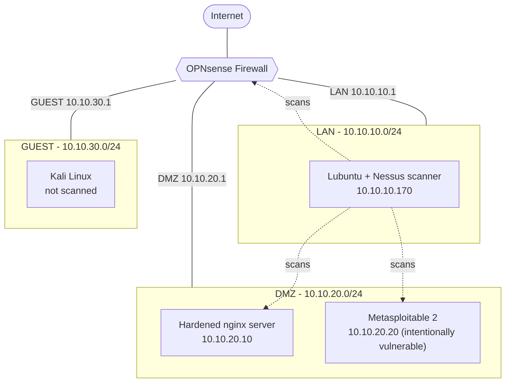
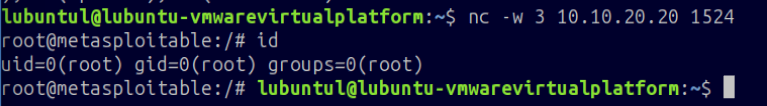
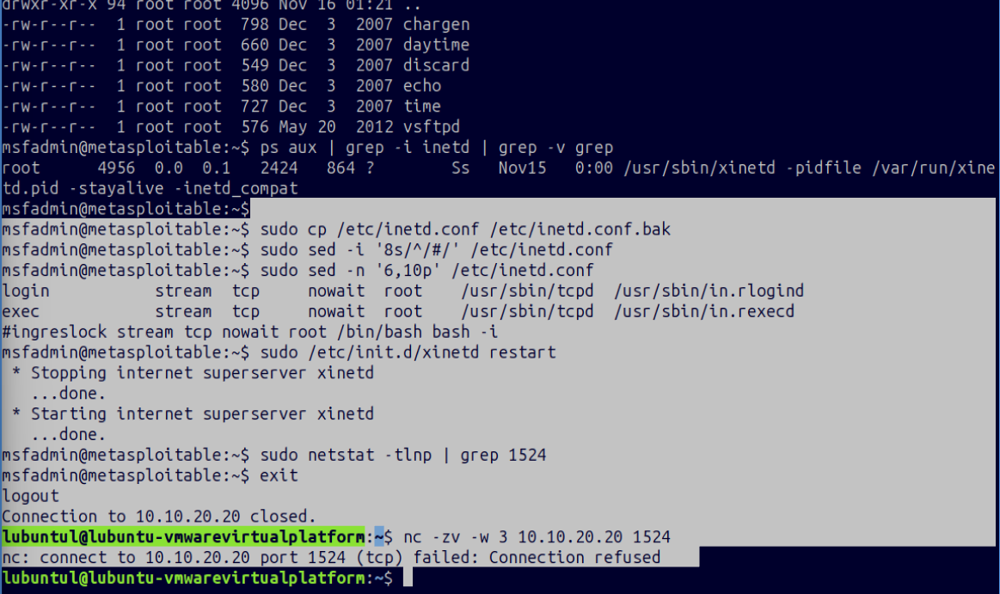
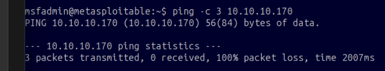
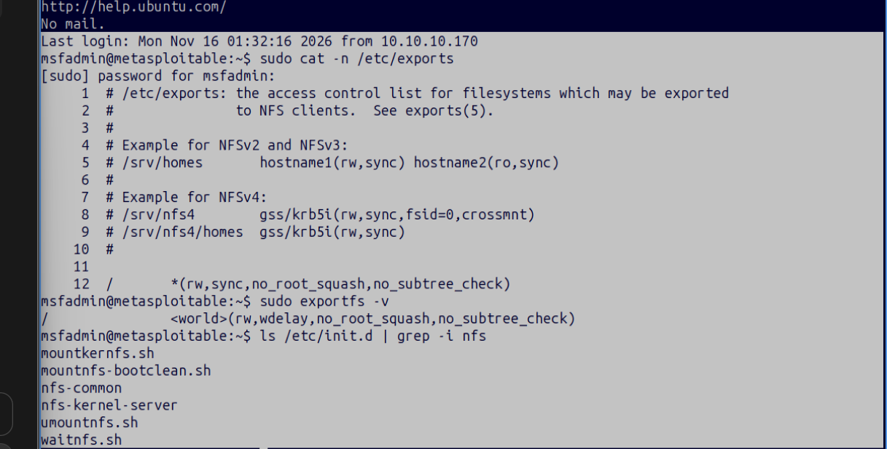
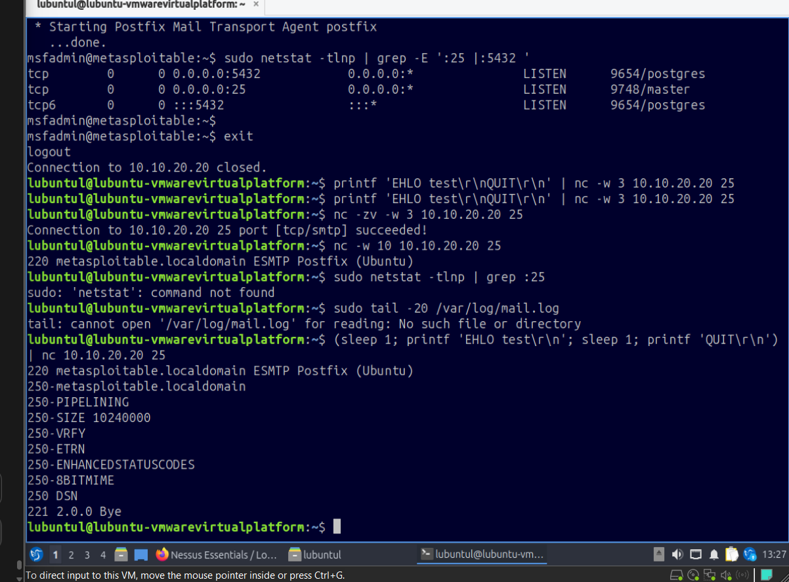

# DMZ Defense: Vulnerability Assessment & Hardening

*Scan it, rank it, fix it, prove it.*

**Nessus Essentials · Metasploitable 2 · CVSS-ranked findings · five verified fixes · before and after rescan**

A vulnerability assessment of the segmented network built in **Project 1 (Three-Zone Fortress)**. A deliberately vulnerable machine (Metasploitable 2) is added to the DMZ so there are real findings. Nessus scans four hosts, the findings are ranked by CVSS, the five most serious fixable ones are fixed one at a time with before and after evidence, and a rescan measures what changed.

**Built:** November 2026 · **Scanner:** Nessus Essentials 10.12.6 · **Hypervisor:** VMware Workstation Pro

## Summary for a non-technical reader

1. I built a small test network and added a computer that is deliberately full of security holes, so there was something real to find.
2. A scanning tool checked four machines and found 49 problems, 12 of them rated Critical.
3. I fixed the five most serious problems that could actually be fixed, including a hidden door that gave anyone on the network full control with no password.
4. A second scan confirmed all five were gone, along with 16 related problems that depended on them. 27 problems remain, down from 49.
5. What remains needs bigger changes, such as replacing end-of-life software or paying for security updates. I recorded those as known risks, and the test machine stays isolated from the rest of the network.

## Results at a glance

Unique findings, Critical to Low, across all four hosts. Informational findings are not counted.

| Severity | Before | After |
|---|---|---|
| Critical | 12 | 7 |
| High | 5 | 4 |
| Medium | 24 | 11 |
| Low | 8 | 5 |
| **Total** | **49** | **27** |

The rescan itself reports 25, not 27. Nessus could not identify the Tomcat web service on port 8180 in either rescan, although Tomcat was still running, so its two findings (one Critical, one Medium) are counted as still open. See [before and after](docs/05-before-and-after.md).

## The five fixes

| # | Finding | CVSS | Host | Fix | Proof it worked |
|---|---|---|---|---|---|
| 1 | VNC server with the password "password" | 10.0 | Metasploitable | VNC disabled | Port 5900 refused, finding gone |
| 2 | Bind shell backdoor on port 1524 | 9.8 | Metasploitable | Backdoor line removed from `inetd.conf` | Port 1524 refused, finding gone |
| 3 | Tomcat AJP "Ghostcat" | 9.8 | Metasploitable | AJP connector disabled | Port 8009 refused, finding gone |
| 4 | NFS exports `/` to everyone, read-write | 7.5 | Metasploitable | Export removed | Empty export list, finding gone |
| 5 | SSL v2/v3 on SMTP and PostgreSQL | 9.8 | Metasploitable | TLS disabled on both services | No `STARTTLS` offered, finding gone |

Disabling TLS on those two services also cleared 15 related certificate and cipher findings. Commands, evidence and rollback steps are in the [remediation log](docs/04-remediation-log.md).

## Architecture

The scanner runs on the LAN client. The vulnerable machine sits in the DMZ, behind the Project 1 firewall rules: the DMZ cannot reach the LAN or GUEST, and can only reach the internet on ports 80 and 443.



## Method

1. Add Metasploitable 2 to the DMZ, verify the download checksum, give it a static address.
2. Install Nessus Essentials on the LAN client and run a baseline scan (Basic Network Scan, no credentials).
3. Rank the findings by CVSS and pick the five most serious that can realistically be fixed. The rest are recorded with a reason.
4. Fix one finding at a time: look first, back up the file, make the change, verify from outside.
5. Rescan with identical settings and compare host by host and finding by finding.

Details: [scope and method](docs/01-scope-and-method.md) · [build log](docs/02-build-log.md) · [findings report](docs/03-findings-report.md).

## Evidence

**The bind shell before the fix.** One command from the LAN client gives a root shell on the vulnerable machine, with no password:



**The same port after the fix.** The backdoor line is commented out, xinetd is restarted, and the port refuses connections:



**The vulnerable machine cannot reach the LAN.** A ping from Metasploitable to the LAN client gets 100% packet loss, because the Project 1 DMZ rule blocks it:



**NFS sharing the whole filesystem to everyone, read-write, with root privileges:**



**SMTP no longer offers TLS** (no `STARTTLS` line in the reply):



All 29 screenshots are in [`screenshots/`](screenshots/) and are referenced from the docs.

## What went wrong and what I learned

Full write-ups are in [docs/06-troubleshooting.md](docs/06-troubleshooting.md).

- **The backdoor port was owned by `xinetd`, but the config line was in `inetd.conf`.** Editing the obvious file would not have worked if I had not checked which program owned the port. It turned out `xinetd` runs with `-inetd_compat`, which makes it read `inetd.conf` as well.
- **The first rescan reported two Tomcat findings as fixed when they were not.** Nessus saw port 8180 open but could not identify the service, in two separate rescans. A direct `curl` showed Tomcat still running. I counted the findings as open and said so, instead of reporting a better result than I could prove.
- **The NFS finding was named "world readable" but was far worse.** The whole filesystem was exported read-write to everyone with `no_root_squash`.
- **Some fixes need a paid repository or a new operating system.** The FFmpeg and SRT updates on the LAN client are only in Ubuntu Pro's `esm-apps` repository, and Metasploitable's Ubuntu 8.04 cannot be patched at all.

## Limitations

- Unauthenticated scan only, with Nessus safe checks on. Nessus detected the FTP and IRC services on ports 21 and 6667 but reported no vulnerabilities on ports 21, 6667 or 3632, although Metasploitable 2 is documented to ship vulnerable versions of vsftpd, UnrealIRCd and distccd. A credentialed scan or targeted checks would likely find more, so 49 is not the full list.
- Counts are unique findings per host. The Nessus screen groups findings differently, so its numbers do not match these.
- Five Lubuntu findings (FFmpeg, libass, SRT) are left open because the fix requires Ubuntu Pro. Two kernel advisories also remained after `apt upgrade`; I did not record the running kernel after a reboot, so I cannot say whether a reboot would clear them.
- A few screenshots were not captured (the Nessus install page and the baseline and final Hosts and Vulnerabilities screens). They are listed in the [build log](docs/02-build-log.md); the HTML reports cover the same ground.
- Disabling TLS on SMTP and PostgreSQL removes weak protocols by removing encryption. That is acceptable on an isolated lab machine whose OpenSSL cannot be upgraded. It is not a production fix.
- Lab only, on an isolated network.

## Repository layout

```
.
├── README.md
├── docs/
│   ├── 01-scope-and-method.md   Scope, tool, policy, scan runs, selection criteria
│   ├── 02-build-log.md          Step-by-step build with commands and screenshots
│   ├── 03-findings-report.md    Findings ranked by CVSS with status and accepted risks
│   ├── 04-remediation-log.md    The five fixes: commands, evidence, rollback
│   ├── 05-before-and-after.md   Baseline vs rescan comparison and its caveats
│   └── 06-troubleshooting.md    Problems, causes and fixes
├── reports/
│   ├── baseline/                Nessus HTML report and parsed CSV, before any fix
│   ├── rescan-1-incomplete/     First rescan (did not detect Tomcat on 8180)
│   ├── rescan-2-final/          Second rescan, used for the comparison
│   └── findings-table.csv       Every Critical to Low finding with its status
├── tools/
│   ├── parse_nessus_html.py     Nessus HTML report to CSV
│   └── compare_scans.py         Baseline vs rescan comparison
└── screenshots/                 NN-description.png evidence
```

To rebuild the tables from the reports:

```
pip install -r requirements.txt
python3 tools/parse_nessus_html.py reports/baseline/baseline-scan.html reports/baseline/baseline-findings.csv
python3 tools/parse_nessus_html.py reports/rescan-2-final/rescan-2-scan.html reports/rescan-2-final/rescan-2-findings.csv
python3 tools/compare_scans.py reports/baseline/baseline-findings.csv reports/rescan-2-final/rescan-2-findings.csv reports/findings-table.csv
```

## Skills demonstrated

Vulnerability scanning and CVSS-based prioritisation · risk acceptance and remediation planning · Linux service hardening (inetd/xinetd, Tomcat, NFS, Postfix, PostgreSQL) · verifying fixes from outside the host · validating scanner results instead of trusting them · parsing and comparing scan data with Python · professional reporting for technical and non-technical readers.
