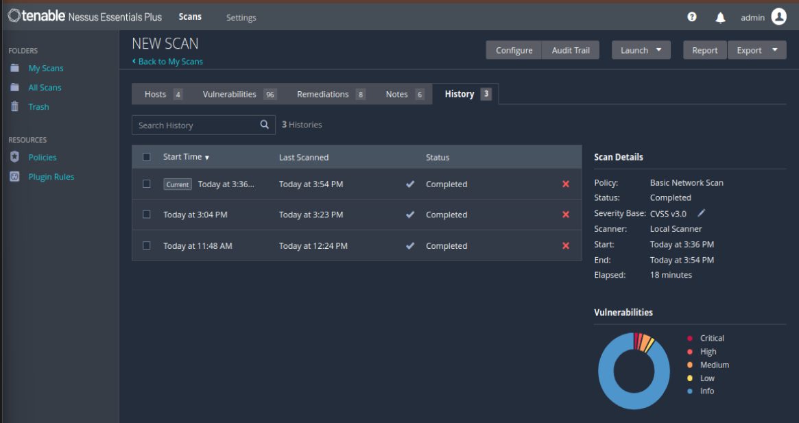

# 5. Before and after

The comparison uses two runs of the same scan (`NEW SCAN`, identical settings): the **baseline** (17 Nov 2026, 11:49 EST) and **rescan 2** (15:36 EST). It matches findings on (host, plugin ID) with [`tools/compare_scans.py`](../tools/compare_scans.py).

The scan history shows the three formal runs of `NEW SCAN`: the baseline (11:48 AM), rescan 1 (3:04 PM) and rescan 2 (3:36 PM).

## Per host

Unique findings, before to after, as scanned:

| Host | Critical | High | Medium | Low |
|---|---|---|---|---|
| `10.10.20.20` Metasploitable | 8 to 2 | 2 to 1 | 19 to 6 | 7 to 4 |
| `10.10.10.170` Lubuntu | 4 to 4 | 3 to 3 | 1 to 1 | 0 to 0 |
| `10.10.10.1` OPNsense | 0 to 0 | 0 to 0 | 4 to 3 | 1 to 1 |
| `10.10.20.10` Web server | 0 to 0 | 0 to 0 | 0 to 0 | 0 to 0 |

## Totals

| Severity | Before | After, as scanned | After, Tomcat counted open |
|---|---|---|---|
| Critical | 12 | 6 | **7** |
| High | 5 | 4 | **4** |
| Medium | 24 | 10 | **11** |
| Low | 8 | 5 | **5** |
| **Total** | **49** | 25 | **27** |

The figures I report are the last column. Nessus did not identify the Tomcat web service on port 8180 in either rescan, so two findings that are still true (Tomcat end-of-life, Critical, and Tomcat default files, Medium) vanished from the scan without being fixed.

## What actually changed

21 findings were resolved by the changes made:

- **5 fixed on purpose:** VNC, bind shell, Ghostcat, NFS, SSL v2/v3.
- **15 resolved as a side effect of Fix 5:** with TLS off on SMTP, the certificate and cipher findings on port 25 have nothing left to report (SWEET32, DROWN, FREAK, RC4, TLS 1.0, self-signed, expired, wrong hostname, STARTTLS injection and others).
- **1 resolved as a side effect of Fix 1:** X Server Detection on port 6000, which disappeared with the VNC server.

Open ports on Metasploitable fell from 28 to 24: 1524, 5900, 6000 and 8009 are gone.

## What was not counted as a fix

| Finding | What the scan showed | What I did |
|---|---|---|
| Tomcat end-of-life, Tomcat default files | Gone from both rescans | Counted as open. A direct `curl -I http://10.10.20.20:8180/` returned `HTTP/1.1 200 OK` from Apache-Coyote, so Tomcat was running. |
| OPNsense: DNS query ID prediction (Medium) | Gone | Counted as not reproduced. It was not in the first pilot scan either, and nothing was changed on that host. |

## The first rescan

Rescan 1 (15:04 EST) showed the same gap on port 8180. I reran it as rescan 2, with Tomcat confirmed healthy, to check whether it was a timing problem. It was not: the second run behaved the same way. Both reports are kept in [`reports/`](../reports/), and the comparison uses rescan 2. The cause is unknown. The only change on that service was the Tomcat restart after the AJP connector edit.

## Things that did not change

- **No finding changed severity** between the baseline and rescan 2. The severity differences seen between the pilot scan and the later scans probably came from a different scan object and a plugin feed update, not from the fixes.
- **The LAN client is unchanged** at 4 Critical, 3 High and 1 Medium. The two kernel advisories were already in the baseline, so they are not new. The package updates that fix FFmpeg, libass and SRT are in Ubuntu Pro only.
- **The hardened web server is unchanged** with no findings above Informational.

## What this comparison cannot show

- It covers an unauthenticated scan with safe checks on. Findings that need credentials or intrusive checks are not in either number.
- It measures what Nessus reports. The direct checks in the [remediation log](04-remediation-log.md) (refused ports, an empty export list, no `STARTTLS`) are the stronger evidence for each fix.
